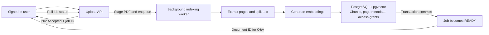
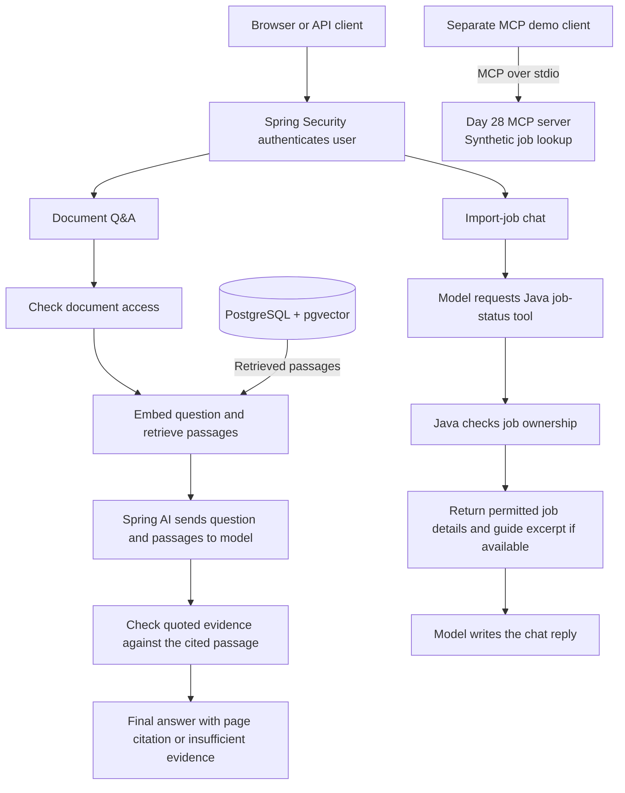

# Document Support Assistant

A Java and Spring Boot project for building a document Q&A assistant with Spring AI. It returns source-based answers with evidence and conversation context.

## About the project

Document Support Assistant is a Java and Spring Boot project that answers questions from uploaded troubleshooting guides and runbooks. It cites the source document and page, and tell users when the documents don't contain enough information.

**Example:** Upload a sample vehicle-data import guide and ask, “Why did my XML import fail with `INVALID_SCHEMA`?” The assistant will explain what to check and point to the relevant page.

## Why this project uses RAG

The assistant retrieves relevant passages from an indexed PDF and provides
them to the model with the question. Before returning a page citation, the
app checks that the quoted evidence appears in the cited passage.

When a guide changes, we index the revised PDF and query its new document ID.
The same model can answer from the updated evidence. Fine-tuning uses training
examples to change model behavior, such as making responses follow a preferred
format more consistently.

## Architecture

### PDF ingestion



### Document Q&A and import-job chat



- **Search modes** — Document Q&A uses vector retrieval. The retrieval API also exposes hybrid search for comparison.
- **Execution limits** — Chat has a workflow timeout and a tool-call limit. Job and guide lookups have their own timeouts, and the SSE stream has a timeout.
- **MCP boundary** — The deployed app calls its Java tool directly. The Day 28 MCP server runs as a separate demo over standard input and output.


## Run locally

Install Docker with Compose. Create a local `.env` in the project root with `DSA_DB_PASSWORD`, `OPENAI_API_KEY`, `OPENAI_CHAT_MODEL`, `APP_TEST_PASSWORD`, and `APP_TEST_PASSWORD_2`. Keep `.env` out of Git.

```powershell
docker compose up --build -d
```

Open [the local app](http://localhost:8080) and sign in as `user` with `APP_TEST_PASSWORD`. The second demo account is `user2` with `APP_TEST_PASSWORD_2`. Check [Actuator health](http://localhost:8080/actuator/health) for `"status":"UP"`.

## Try document Q&A

Upload [the sample PDF](docs.samples/sample-input-file.pdf), wait for indexing to finish, and ask “How large can my file be?” The assistant should answer **10 MB** and cite page 2.

## Try the chat API in Bruno

Use **Basic Auth** with the `user` account and `APP_TEST_PASSWORD`. Send a **POST** request to `http://localhost:8080/api/chat`. Choose **JSON** in the Body tab and enter the following.

```json
{"conversationId":"demo-1","message":"Source text: The maximum upload size is 10 MB.\nQuestion: What is the upload limit?"}
```

A valid message returns **200 OK**.

```json
{"answer":"The maximum upload size is 10 MB.","evidence":"The maximum upload size is 10 MB.","supported":true}
```

A missing or blank message, or a message longer than 2,000 characters, returns **400 Bad Request**.

## Run tests

Use JDK 21 and start Docker for the PostgreSQL Testcontainers integration test.

```powershell
.\mvnw.cmd test
```
## Application Flow

```text
ChatController → validate → AssistantService
  → instructions + history → model → DocumentAnswer JSON

Provider failure → ModelProviderException
  → ChatExceptionHandler → HTTP 502 + ChatError
```
## Bruno Regression Tests

Start the app, open `bruno/documentsupportassistant` in Bruno, and run `regressionTesting` in sequence. The supported-answer request seeds the same-ID follow-up. Restart the app before a clean run to clear history.

Coverage: supported answers, missing evidence, blank and oversized messages, same-ID follow-ups, and fresh-ID isolation. Live model calls incur API usage.

## Evaluation and deployment

See the [evaluation and deployment report](evals/project-report.md).

## Current Limitations

- Conversation history is in memory and resets on restart.
